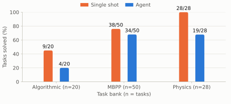
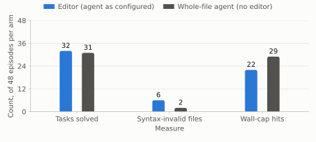
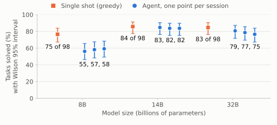
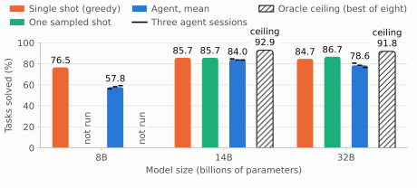
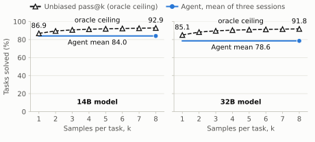
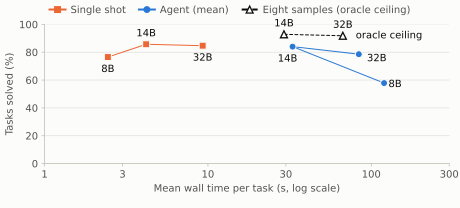

# An Agent Scaffold Did Not Beat a Single Sampled Answer at 14B or 32B: Pre-Registered Tests of DeepSeek Harness 0.1.1rc1 with Open Qwen3 Models

Josiah McJunkin

## Abstract

I tested whether wrapping a small open-weight model in an agentic scaffold raises the number of programming tasks it solves, compared with a single answer from the same model, and ran four pre-registered experiments on one fixed set of 98 tasks, graded by hidden tests in an isolated verifier. Scaling from 8B through 14B and 32B collapsed the deficit. Under a 600-second per-episode budget, the agent solved fewer tasks than a single greedy answer, 57 against 75 at about 15 times the wall time, with 21 discordant pairs against 3 (exact sign test p = 0.0003) at 8 billion parameters. Removing the agent's incremental editing tool did not close the gap, refuting the mechanism I had proposed. At 14B and 32B no agent session differed significantly from the single-shot arm, and the agent began solving a few tasks that greedy decoding missed. In the final experiment I compared the agent with a single sampled answer at the same temperature and with eight sampled answers at roughly the same wall time. At either scale where that comparison ran, the agent never beat one sampled answer, and its extra reach over greedy decoding was contained in what sampling reached. The scaffold bought parity at best, at eight to nine times the wall time. Every result here applies only to harness version 0.1.1rc1 driving open Qwen3 models through a request-rewriting proxy, not to the native DeepSeek models the harness was designed for, and not to the 0.2 releases that I have not evaluated.

## 1. Introduction

Agent harnesses give a language model tools, a working directory, and many turns in which to act. The widespread expectation is that this arrangement raises the capability the model can express. The expectation is easy to hold and hard to test, because an agent costs far more per task than a single call and because its outcomes vary between runs in ways that the outcomes of a single deterministic call do not.

DeepSeek released an open-source harness in August 2026 whose minimal configuration is designed for benchmark use. It runs one headless agent episode per isolated workspace and accepts any endpoint that speaks the OpenAI chat protocol, and I asked a narrow question about it, which was whether wrapping a model in this scaffold solves more tasks than asking the same model for one answer when the model, the task set, and the grader are all held fixed.

I answer it in four steps, in which the first experiment measures the raw difference at 8B and the second tests my explanation for that difference by removing the tool that I blamed. The third repeats the comparison at 8B, 14B, and 32B with multiple independent agent sessions per scale. The fourth asks whether the agent outperforms the cheapest alternative at the same cost, which is to sample the model several times.

## 2. Methods

### 2.1 Tasks and grader

The suite contains 98 tasks drawn from three banks. Twenty are a held-out set of algorithmic problems, fifty come from the MBPP benchmark, and twenty-eight are physics formula rearrangements. I froze the manifest (task identifiers, README content hashes, and test-file content hashes) before the first scored episode and verified it by hash on every machine that ran a campaign. Each task has a README containing the specification and a hidden test file. A solution counts as solved only when every hidden test passes in the verifier, which executes outside the agent's workspace and was not accessible to the agent during any episode.

### 2.2 Arms

The single-shot arm sends the task prompt once with greedy decoding (temperature 0, at most 2048 new tokens, thinking disabled) and extracts the last fenced code block, falling back to the whole response when no fence is present, so that a response which is not valid code fails the hidden tests and counts as a failure.

The agent arm launches the harness in a fresh workspace that holds only the README, and the agent has a persistent shell and, unless stated otherwise, a string-replacement file editor. It may write and run its own tests, but it has no access to the hidden tests. The same verifier grades both arms. The candidate is whatever stands in the solution file when the episode ends, whether or not the agent declared itself finished, and the agent samples at the model's default temperature of 0.6. Each episode has a wall-clock cap of 600 seconds and a limit of 4096 tokens per request. The prompt was held identical across every experiment that used the agent, except in the second experiment where the file-writing instruction was changed to match the removed tool.

The two arms differ in their sampling procedure, since greedy decoding is set against temperature 0.6. I registered this deliberate asymmetry in advance as a confound, because each arm runs the way its own tool is normally used.

### 2.3 Models and serving

The first two experiments ran a community-modified 8B variant of Qwen3 with its refusal behaviour removed, served through Ollama on a local Apple Metal machine with shared memory. The last two experiments ran the official Qwen3 weights at 8B, 14B, and 32B on an academic HPC cluster using NVIDIA A30 GPUs with 24 GB each, on one exclusively allocated node per rung. Context length was held at 8192 tokens throughout, which kept the serving configuration comparable across every scale.

The harness was pinned to version 0.1.1rc1. Its adapter always sends a reasoning-effort field in its own vocabulary and ignores per-model overrides in the configuration file. The serving software I used disables thinking only for a wire value that the adapter cannot produce. I therefore placed a small proxy between the harness and the server that rewrites exactly two request fields and passes everything else through unchanged. Before each campaign I verified that a request carrying the harness's own fields returned content and no hidden reasoning.

### 2.4 Statistics

Every comparison is paired by task, and the primary test is an exact two-sided sign test on discordant pairs at a significance level of 0.05 that was fixed before any data were collected, with intervals on rates given as Wilson 95% intervals. The sample size for each test is the number of discordant pairs and not the number of tasks, and I report that count beside every p-value. I did not correct for multiple comparisons. Where I ran three agent sessions at one scale, they share their tasks and their single-shot reference, so they are repeated measurements and not independent tests. Throughout, a "session" means one complete pass of the agent over the full suite.

### 2.5 Pre-registration and integrity controls

I committed a protocol for each experiment before any scored episode. The protocols fixed the question, the suite, the arms, the endpoints, and the exclusion rules. Changes made after registration were written as dated amendments before the affected episodes ran, and I describe the amendments in the appendix. Three controls ran in every experiment that included the agent arm. An episode with no usable transcript was never scored. An episode that spent its whole token budget with zero tool calls and zero visible output was classified as an infrastructure failure and retried rather than scored. A scan of every transcript checked for access to the hidden tests, and the scan was tested on a planted violation and on an innocent episode before the first run, so that its silence in the campaign would be evidence rather than oversight.

### 2.6 Interpretation pre-commitments

For the first and third experiments I wrote interpretation pre-commitments while results were still incomplete, fixing in advance how I would read the numbers regardless of what they turned out to be. The first experiment's pre-commitment was written at 29 of 98 pairs (the single shot led 21 to 13, with all eight discordant pairs favouring it). It stated that a significant deficit would be reported as specific to this budget and this scale, that the wall-cap rate would be treated as a first-class result and not a footnote, and that the cap would not be changed mid-campaign. The fourth experiment's pre-committed readings, written before any episode ran, described three branches keyed to where the agent fell relative to one sampled shot and to the oracle ceiling, plus a commitment to report the shape of the pass-at-k curve regardless of the branch. The registered primary endpoint for each rung was agent session 1 against the single-shot arm. The third experiment's pre-commitment was written on 2026-09-21 after the 8B and 14B rungs finished but before the 32B rung completed, and it fixed a three-way reading for whatever 32B delivered.

## 3. Experiment 1 (DSH-1). An agent against one answer at 8B

The first experiment was registered on 2026-08-22 and ran both arms on all 98 tasks, paired back-to-back for each task. The agent operated under a 600-second per-episode budget and cost about 15 times the wall time of a single greedy answer.

{{T:dsh1_main}}

{{T:dsh1_banks}}

The agent never won more than three tasks that the single-shot arm lost. Its largest deficit was on the physics bank, where the single shot solved every task.

The wall-clock cap is part of the treatment, so I bounded its influence. Of the 18 capped episodes that failed, 8 were on tasks that the single shot solved.

{{T:dsh1_sens}}

Granting the agent every capped task that the single shot solved leaves a significant gap. The gap disappears only under the further assumption that additional time would also have won the agent all ten capped tasks that the single shot itself could not solve. Across all 98 tasks the agent won exactly three tasks the single shot missed, and none in two of the three banks, so that assumption contradicts the data. The direction is robust. The p-value is not free of the budget.

Across all 98 agent episodes there were 361 tool errors, 301 of them failed string-replacement matches. Of the 41 unsolved candidates, 16 failed on wrong logic, 13 were not valid Python, 11 hit the wall cap, and 1 timed out in the verifier, each counted under its first matching category. Eight of the nine physics losses were syntax-invalid files rather than wrong answers. I tentatively attributed the deficit to the agent damaging its own files through repeated incremental edits. That attribution was correlational, and I tested it directly in the next experiment.

I found the data integrity of this experiment to be clean, because all 98 pairs were scored with zero excluded, zero infrastructure retries, zero violations from the hidden-test scan, and every scored pair mapping to exactly one transcript verified to belong to that episode.

## 4. Experiment 2 (DSH-2). Is the deficit caused by file editing?

This experiment was registered on 2026-08-26 with a falsifiable prediction recorded in advance. If file editing caused the deficit, removing the editor should recover most of the syntax-invalid losses, and the treatment arm should outperform the control significantly. If it did not, the explanation was wrong and would be corrected.

In the treatment arm I removed the editor component from the harness composition entirely, leaving a shell as the only way to write files. Single-shot was not part of the mechanism test, since the comparison of interest was between two agent configurations and the single-shot rate on these tasks had been measured days earlier under identical conditions. The control arm kept the editor, and both ran on the 48 tasks of the physics and algorithmic banks, where the damage had been most visible, paired by task.

{{T:dsh2_main}}

Before the campaign, a known-positive probe ran the treatment arm on a physics task that the control had lost to an indentation error. The probe made 60 shell calls and zero editor calls, produced a file that compiled, and passed the hidden tests, though it still ran to the 600-second cap. Zero editor calls occurred in any treatment episode during the campaign, confirmed in every individual transcript. One episode routed around the absence of the editor with six bash in-place edit commands, which I counted and reported per the protocol but did not treat as a second exclusion. The treatment hit its mechanical target. It eliminated tool errors completely and cut invalid files by two thirds, yet the solve rate did not move. The agent spent the recovered effort timing out instead (29 cap-hits in the treatment against 22 in the control), and my pre-registered prediction was therefore refuted. File damage was a symptom and not the binding constraint. The binding constraint was that the loop did not converge inside its budget.

### 4.1 The agentic arm does not replicate across sessions

While running this experiment I noticed an unplanned finding that turned out to be more important than the mechanism test. Three days apart the results differed. The control arm here is configured identically to the first experiment's agent arm (same composition, same prompt, same model, same cap, same proxy, same verifier) and ran on the same 48 tasks.

{{T:dsh2_repl}}

Greedy single-shot reproduced exactly, with no task changing outcome, while the agentic arm moved by nine tasks. After the control arm's shift was known, and before re-running single-shot, I registered a dated addendum on 2026-08-27 with two readings. If single-shot reproduced within two tasks of 37 of 48, the instability would be specific to the agentic arm. If it also moved by several tasks, the instability would be environmental. Single-shot reproduced at 37 of 48 (zero changes), so the instability is specific to the agentic arm. The third experiment narrows what kind of instability it is.

Rederiving the first experiment's paired comparison on this 48-task subset in each session, the gap was 14 discordant pairs (all favouring single-shot) in session 1 and five (all favouring single-shot) in session 2, giving p = 0.0001 in session 1 and p = 0.0625 in session 2. The first experiment's within-session paired design remains valid, because pairing controls for session effects within a session, but its single-session p-value overstated how reliably the effect size reproduces. A sampled multi-step agent needs multiple sessions before an effect size can be reported, because the session count is the effective sample size for the magnitude of the gap, just as the discordant count is the sample size for the test.

Across 96 paired observations in two independent sessions, the agent won zero tasks that the single shot lost (A-only 14 then 5, B-only 0 then 0). The direction never varied and only the magnitude did, which is why I treat the direction as the sturdier claim and the size of the gap as unsettled.

## 5. Experiment 3 (DSH-3). Does the deficit survive scale?

This experiment was registered on 2026-09-21. In a single design, it addressed two open questions. The second was whether the agent's variance could be bounded, following the second experiment's finding that a single session was not enough. The first was whether the deficit persisted at larger scale, which was the most obvious confound from the first experiment, since the agent's failure modes (non-convergence, invalid files) are exactly what should improve with capability. I ran the single-shot arm once and the agent arm in three independent concurrent sessions at each of 8B, 14B, and 32B, using the official Qwen3 weights. Importantly, the three agent sessions at one rung ran on separate GPUs, each with its own server instance and proxy, in the same time window on the same exclusively allocated node. They therefore measure the scaffold's sampling stochasticity, not temporal drift. Claims about them say "across independent concurrent sessions" and not "across days".

Before relying on greedy single-shot, I checked its determinism on the cluster by running it twice, and it agreed with itself on all 12 probe tasks. I had pre-registered that check as a gate.

{{T:dsh3_ladder}}

{{T:dsh3_sessions}}

At 8B all three sessions are significant, with discordance running almost entirely against the agent (A-only 18 to 21, agent-only 0 to 2). At 14B no session comes close to significance, and the agent begins winning tasks the single shot misses (agent-only 2 to 4). At 32B the point estimates reopen somewhat, but no session reaches significance (best p = 0.0574). A design with three sessions per rung cannot separate 14B from 32B, because the smallest achievable two-sided rank p for three against three is 0.10. The honest summary is that 8B is significantly worse, while 14B and 32B are not distinguishable from parity or from each other.

The non-monotone point estimates (+18.3, +1.7, +6.0) needed checking. I had pre-committed before the 32B rung finished that if the gap reopened I would check the budget artifact first and would not construct a narrative. Granting every capped 32B loss on a task that the single shot solved moved all three sessions further from significance (p = 0.79, 0.58, 0.34), so the reopening is not a budget artifact.

{{T:dsh3_mech}}

The two failure modes that the earlier experiments identified collapse together with the gap. The 8B agent used about 24 steps and 4,362 tokens per task and still finished behind a single answer. The 14B agent converged in about 5.4 steps and 926 tokens. Syntax-invalid files dropped from 15 to 17 per session at 8B to 1 to 3 at 14B, and cap-hits dropped from 11 to 14 to 0 to 3. Neither file damage, which the second experiment had refuted directly, nor the wall cap explains the 8B deficit. The reading that I draw from this co-movement is that capability was the cause, since a scaffold cannot rescue a model that cannot drive it.

The three concurrent sessions at one scale spread by 1 to 4 tasks, far less than the 9-task swing in the second experiment three days apart. I therefore read the earlier swing as drift over time or across server state, to which the agentic arm is sensitive and greedy decoding is not, and not as the scaffold's own sampling stochasticity. I had registered this distinction before the data existed.

The first experiment's abliterated-weights caveat from the protocol is retired by these data. The single-shot arm scored 75 of 98 on the cluster with official Qwen3 weights, identical to the result on the local machine with the community-modified variant. The agent landed 55 to 58 against the local machine's 57. The finding reproduces across both weights and hardware.

### 5.1 Saturation

After writing these results I audited how many tasks could discriminate between the arms at each scale. A task is informative only if the arms can differ on it, and a task where all arms solve or no arm solves cannot contribute to any discordant pair.

{{T:dsh3_audit}}

The suite is well matched to 8B, where 40 tasks are informative, but it is largely saturated at 14B, where only 12 are, so the parity claim at 14B rests on thin evidence and I do not offer it as a precise equivalence.

### 5.2 Retracted test

While examining complementarity I computed a sign test for the union of single-shot and one agent session against single-shot alone. That test is degenerate. A union can only add solves, so every discordant pair favours the union by construction, and the test has no null hypothesis to reject. I retracted it. The descriptive gains survive and are useful as context for the fourth experiment. Adding one agent session to greedy single-shot added 0 to 2 tasks at 8B, 2 to 4 at 14B, and 3 to 6 at 32B. Greedy single-shot is deterministic (verified on the cluster), so re-running it recovers none of those tasks, and whether the agent's coverage came from something beyond sampling is the question the fourth experiment addresses.

## 6. Experiment 4 (DSH-4). An agent against sampling at equal cost

This experiment was registered on 2026-09-25, before any of its scored episodes ran, and was analysed on 2026-10-29. The third experiment had shown the agent reaching parity with greedy single-shot at 14B and 32B while costing roughly 8 to 9 times as much wall time. I drew eight independent samples per task at the agent's own temperature of 0.6 on both the 14B and 32B models, each graded independently by the same verifier. From the cost data, the wall-matched N was 8 at 14B and 9 at 32B.

The agent data come from the third experiment's three sessions per rung, collected on the same node with the same serving stack, days earlier. The agent arm was not re-run, because the comparison is between new sampled data and an already-measured distribution, and re-running the agent would only add cost, not validity. The realised wall time for eight samples was 29.2 seconds per task at 14B and 67.0 seconds at 32B, against the agent's 33.0 and 83.9 seconds, so the budget favoured the agent slightly.

The pre-committed readings described three branches. If the agent exceeded the oracle ceiling over eight samples, the scaffold would contribute something sampling cannot buy. If it fell between one sample and the ceiling, the result would be ambiguous, because the ceiling is unreachable. If it matched or fell below one sample, the scaffold would add nothing beyond a single shot. The pass-at-k curve's shape was to be reported regardless of which branch the data reached, and the data landed in the third branch.

{{T:dsh4_primary}}

The agent never outperforms a single sampled answer, and I regard this as the decisive comparison. The unbiased pass-at-1 estimates are 85.1 and 83.4. Here "one sampled shot" means the first of the eight stored samples per task, which solved 84 of 98 at 14B and 85 at 32B. A single sample costs roughly one eighth of the agent's budget. At 14B the two are level, while at 32B the agent trails in every session and trails significantly in one. At 32B every agent session falls below both the stored sample and the unbiased estimate.

The best-of-eight solve count is reported strictly as an oracle ceiling. It counts a task as solved when any one of eight samples passes the hidden tests, which no deployed system can determine without access to the hidden grader, and it therefore bounds every possible selection rule from above and does not measure anything a user could obtain.

The agent solved a few tasks beyond greedy decoding in the third experiment, but sampling reaches those tasks as well.

{{T:dsh4_reach}}

The agent's extra coverage over greedy decoding is contained in what sampling reaches, and at most one task in any session was solved by the agent and missed by all eight samples.

Unbiased pass-at-k estimates from the stored samples, reported as solved-task counts per 98, appear below.

{{T:dsh4_ceiling}}

The curve flattens by three or four samples, so the realistic alternative to the agent is a few samples rather than eight.

{{T:dsh4_cost}}

## 7. Discussion

Taken together, the four experiments indicate that this harness, at this version and with these models, does not raise the solve rate above what a single answer achieves. At 8B the scaffold is clearly harmful. At 14B and 32B it reaches parity at best. At the two scales where I compared the agent with a single sampled answer at the same temperature, the agent never won. The agent's extra reach over greedy decoding fell within the oracle ceiling of eight samples, so no task it solved was out of sampling's reach, although that ceiling is not itself an achievable score. The mechanism I first proposed was wrong. The deficit tracks the capability of the model, not the design of the tools, and only the direct intervention revealed the error.

Two methodological points seem more general than this particular result. First, the variance of an agent arm is large enough to need its own measurement. A deterministic baseline can be measured once, but a sampled multi-step agent needs repeated sessions before an effect size is reported, and the session count is the effective sample size for the magnitude of the gap. Every defect I found before the first scored pair produced records that looked like ordinary data, and none was visible in the outputs. Second, an agent's failures can look like results, and all were found by auditing token accounting, request contents, transcript presence, and tool results.

## 8. Threats to validity

The agent data in the fourth experiment come from the third experiment, collected on the same node but days earlier, while the sampled arm is new. The agentic arm is precisely the one that the second experiment showed drifting across sessions. The 32B deficit of 6 to 10 tasks against one sampled answer would need a large favourable drift to reverse, but the confound is real and named here rather than in a footnote.

The third experiment's three concurrent sessions per rung measure the scaffold's sampling stochasticity. They do not measure temporal drift, which is the kind of instability the second experiment documented. Claims about session spread say "across independent concurrent sessions", and the distinction from the days-apart finding is recorded.

The single-shot arm decodes greedily and the agent samples at 0.6, so the arms differ in more than the scaffold. The single-shot score of 75 of 98 was identical on both machines, and the agent landed between 55 and 58 on the cluster against 57 on the local machine, which supports comparability. The 600-second cap is part of the treatment, and the editor-removed arm from the second experiment was never repeated on the cluster. The first two experiments used a community-modified model on one machine, and the last two used official weights on a different machine.

The suite contains 98 tasks drawn from three banks and one model family, and it saturates at scales above 8B. At 14B the parity verdict rests on 12 informative tasks, which does not overturn it but limits the precision with which parity can be claimed. Eighteen session-level tests were run without correction for multiple comparisons, and the three sessions at any one scale share their single-shot reference and their tasks, so the conclusions rest on the direction and the consistency of the results across sessions and not on any single p-value.

The retracted union test (p = 0.0312 for single-shot-plus-agent against single-shot alone) was a degenerate comparison. A union can only add solves, so the test had no null hypothesis to reject. I withdrew it on the same day. The descriptive counts that survived it are reported in Section 5.2.

## 9. Scope

These results apply to version 0.1.1rc1 of the harness, in its minimal benchmark configuration, driving open Qwen3 models of 8B, 14B, and 32B parameters through a local proxy that rewrites the reasoning-effort field. They do not apply to the native DeepSeek models that the harness was built and tuned for, and I did not run one. They do not apply to the 0.2 releases, which I have not evaluated.

## 10. Code and Data Availability

I have placed the code, the per-task outcome data, the pre-registered protocols with their dated amendments, and the figure scripts in the repository at github.com/the authorMcj/Crutch. Every table and every figure in this paper is generated from the data by script. Raw agent transcripts are not included.

## Appendix A. Amendments and defects fixed before scoring

The first experiment required five launch attempts before a single valid scored pair was produced, and six defects were found and fixed through dated amendments, each written before the affected episodes ran. The run that preceded most of these changes had scored five pairs (three concordant-pass, two concordant-fail, zero discordant), all of which were voided wholesale regardless of direction. No voiding was outcome-driven.

The amendments, dated against their registration of 2026-08-22, were as follows.

**2026-08-22 (pre-run).** Two rules added before the first scored episode. If the wall-clock cap terminated an episode, the candidate file present at termination would be graded rather than discarded (a timed-exam rule). The hidden-test scan would treat the agent naming its own test files inside its own workspace as innocent, convicting only on references to the repository's evaluation infrastructure.

**2026-08-23 (pre-verdict, mechanism-driven).** The model was reasoning in a hidden channel that the harness could not read. Every failed episode showed zero tool calls, the full 4096 tokens consumed, and zero visible output. The harness sent a field that the server ignored, and thinking consumed the entire token budget. The five scored pairs from the earlier run and all pilot episodes were voided and archived. The composition was changed so that the correct wire value would be produced.

**2026-08-23b (pre-run).** The previous fix did not reach the wire, and the harness's enumeration had no value that the server would accept. The fix was a small proxy that rewrites two fields in every request, validated by recording the server's behaviour with and without the proxy before any scored episode. A logging proxy placed in front of the server during a live episode showed that the adapter sent its own level name, ignoring the composition's override.

**2026-08-23c (pre-run).** Transcripts were written inside the throwaway workspace, because the output directory was resolved as a relative path against the agent's working directory. The cleanup step deleted them, and the hidden-test scan reported silence, because it saw no transcripts. A missing transcript was reclassified as an infrastructure error, never a score, because a scan reporting no violations against no evidence is not meaningful. The fix was to resolve the path to an absolute form at startup.

**2026-08-23d (pre-run).** Three fixes. The single-shot arm had no token accounting and no transcript, so it could produce unauditable data. A guard was added to record token counts and flag any leaked reasoning, which the agent arm already had. Unknown pairs were split by cause into the configuration-class (the registered condition was not delivered) and environment-class (transient hardware or server errors), because blocking the campaign on a transient event from a neighbouring process would have deadlocked the launch. The workspace path was changed from a 60-character random temporary directory to a short, meaningful path, after a smoke test showed the model spent all of its turns mistyping the long path and failing on a permission error.

**2026-08-23e (pre-run).** Because the harness keys its transcript directory on the encoded workspace path, a stale transcript from a killed earlier run was attributed to a fresh episode, and two directories existed for the same task from two different workspaces. The fix required exactly one matching transcript per scored pair, preferring the directory whose path names the current workspace, and an attribution audit was added to the verdict script as a known-positive check. The campaign had recorded zero pairs when this defect was found, so it restarted from scratch and all 98 pairs ran under one code version.

## Appendix B. Exploratory observations (not pre-registered)

On the 23 tasks that 8B single-shot failed, a selector independent of the 14B and 32B arms, the agent at 14B solved 9 to 11 of 23 against single-shot's 10 of 23, and at 32B solved 7 to 9 of 23 against single-shot's 9 of 23. Even where there was headroom, the agent did not beat single-shot. It traded tasks rather than adding capability, and every session-level comparison gave p at or above 0.69.

This slice uses exactly 23 tasks and an independent selector (tasks that the 8B single-shot arm failed, chosen without reference to the 14B or 32B arms), so it is not circular. It was chosen after the main results and is reported as a hypothesis for a future registered experiment, not as a finding.